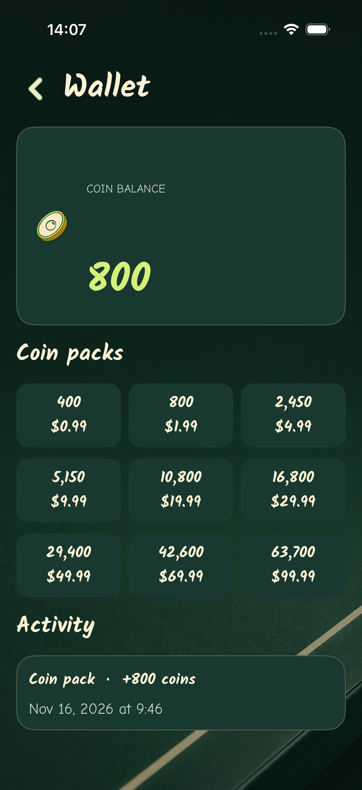
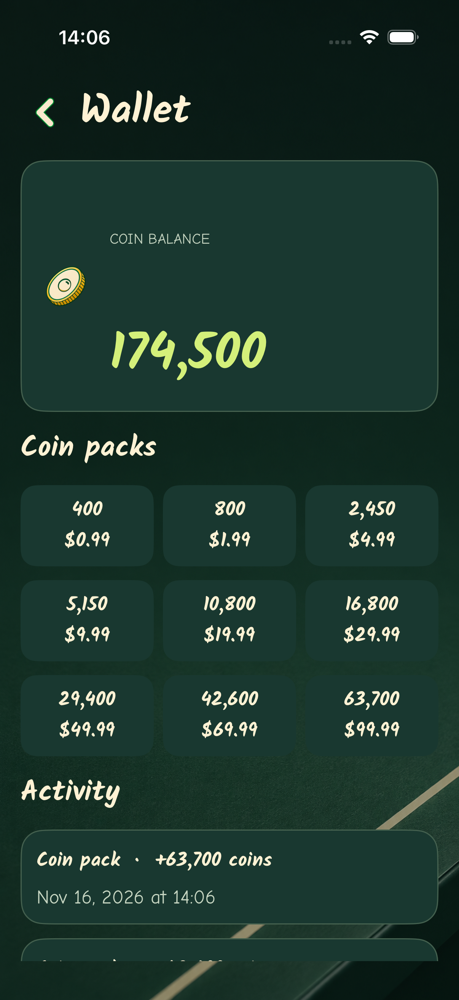

# Full function and wallet acceptance

November 16, 2026, Asia/Shanghai

## Environment and scope

Tested the current workspace source on Vava UI Acceptance, iPhone 17 Pro, iOS 26.0.1 (23A8464), device `C6BBDAF1-EF03-4F2E-980F-CB8C472367D6`, with Xcode 26.0.1. Debug and Release simulator builds succeeded. The latest Debug build was installed over `im.seex.sao2` without resetting its data.

Destructive and purchase cases ran in the isolated `com.vava.pingpong.acceptance.nov13` app. Its App, Assets, and Configuration directories matched the workspace. The original profile was read only. Its Application Support file hashes matched the pre-test snapshot after all tests; its wallet retained 800 coins and one purchase entry.

## Results

Seventeen distinct UI cases ultimately passed. The 11 standard-size cases and one accessibility case passed on their first runs. Additional wallet cases covered ordinary launches, mode consistency, repeated purchases, injected failure, deferred approval, simulator restart, and every coin pack.

| Area | Observed coverage |
| --- | --- |
| Entry | Consent gate, clearing its error, both agreement browser sheets, first-tab selection and restart |
| Shorts | Playback, pause, paging, search, sharing, likes, saves and restart persistence |
| Comments and sources | Editorial/private comments, replies, following, drafts, blocking/unblocking and report hiding |
| Academy | Search, free filter, single-line detail title placement, saves, practice progress, paid gate and unlock |
| Watch | Search, details, save, publisher browser, sharing and replay-specific hide confirmation |
| Chats and profile | Contact validation, saved drafts, unavailable-Mail handling, name/bio persistence and photo selection |
| Local library | Photos video import, transcode, playback, removal, sign-out/re-entry, isolated account deletion, refresh and media credits |
| Accessibility | Single-column coin packs and vertically arranged profile collections; original text size restored |

## Wallet checks

- All nine offers loaded. Native cancellation, pending approval and declined approval created no credit.
- A 400-coin purchase followed by a 45-coin course unlock left 355 coins after restart with one purchase entry.
- Ordinary launch without the Xcode environment flag credited 800 coins. Switching between ordinary and explicitly local launches preserved that balance and one entry.
- Two further 400-coin purchases raised the isolated balance to 1,600, each credited once. An injected StoreKit purchase error left that balance unchanged.
- An 800-coin pending purchase was approved while the app was terminated. Relaunch recovered it, producing 2,400 coins and four entries. Three launches alternating environment settings and a completed sign-out/sign-in preserved the balance.
- A full simulator shutdown and boot preserved the test account's 2,400 coins and the original account's 800 coins, verified in the UI.
- Each of the nine packs was then purchased through the UI: 400, 800, 2,450, 5,150, 10,800, 16,800, 29,400, 42,600 and 63,700. Each credited its expected quantity. Their combined 172,100 coins increased the test balance to 174,500. Relaunch retained that balance and exactly 13 purchase entries.

The first extended wallet run failed its login assertion because the new test terminated the app without observing completed sign-out. The test now explicitly targets the confirmation alert and waits for the login screen before termination. A fresh isolated installation passed the rerun. No app source change was needed during this acceptance run.

## Evidence and limits

Result bundles and the XCTest harness are under `/tmp/vava-acceptance.0z0B6Y`: `full-nov16-main.xcresult` (11 passed), `full-nov16-accessibility.xcresult` (1 passed), `full-nov16-wallet.xcresult` (2 passed, 1 failed), `full-nov16-wallet-retry.xcresult` (2 passed), and `full-nov16-reboot-packs.xcresult` (2 passed). Repeated cases are counted only once in the 17-case total.

The static verifier passed 536 checks; recursive strict Swift format lint and diff whitespace checks passed. Existing compiler warnings remain outside this run's changes.

Payments used local StoreKit Test. Apple sandbox and production checkout were not tested. Browser-sheet presentation does not certify external playback or agreement content availability. Mail delivery and VoiceOver were not tested. The app has no connected authentication or live messaging service.

